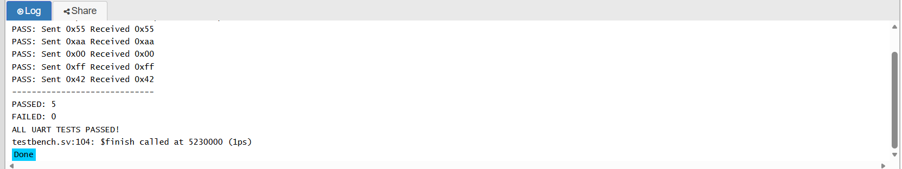
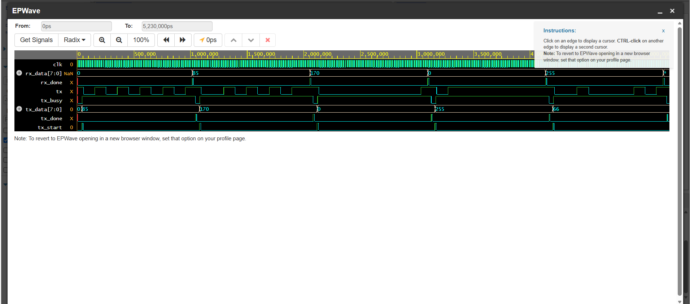

# UART Serial Communication System Using Verilog

An 8-bit UART (Universal Asynchronous Receiver/Transmitter) communication system designed using Verilog HDL and verified through automated simulation.

This project implements a UART transmitter and receiver using finite state machines (FSMs), clock-based timing, and serial data communication.

## Project Overview

UART is a widely used serial communication protocol in embedded systems, microcontrollers, robotics, and digital electronics.

The objective of this project is to design and simulate a UART system capable of transmitting and receiving 8-bit data reliably.

The transmitter and receiver are connected in a loopback configuration to verify correct data transfer.

## Features

- 8-bit serial data transmission and reception
- UART 8N1 protocol: 8 data bits, no parity, 1 stop bit
- Configurable clock cycles per bit
- FSM-based transmitter and receiver
- Start-bit detection and validation
- Data-bit sampling near the bit center
- Stop-bit validation
- Transmission busy and completion signals
- Receiver completion signal
- Automated simulation testbench
- VCD waveform generation

## System Architecture

```text
          8-bit Input Data
                 |
                 v
        +------------------+
        | UART Transmitter |
        |     uart_tx.v    |
        +------------------+
                 |
                 | Serial TX
                 v
        +------------------+
        |  UART Receiver   |
        |     uart_rx.v    |
        +------------------+
                 |
                 v
          8-bit Output Data
```

The testbench connects the transmitter's serial output directly to the receiver's serial input.

## UART Communication Format

Each transmitted frame consists of:

| Field | Description |
|-------|-------------|
| Start bit | 1 bit, logic LOW |
| Data bits | 8 bits, least significant bit first |
| Parity | None |
| Stop bit | 1 bit, logic HIGH |

The serial line remains HIGH when idle.

## Finite State Machine Design

Both UART modules use four states:

| State | Transmitter | Receiver |
|-------|-------------|----------|
| IDLE | Waits for transmission request | Waits for start bit |
| START | Transmits start bit | Validates start bit |
| DATA | Sends eight data bits | Samples eight data bits |
| STOP | Sends stop bit | Checks stop bit |

### FSM State Flow

```text
      +--------+
      |  IDLE  |
      +--------+
           |
           v
      +--------+
      | START  |
      +--------+
           |
           v
      +--------+
      |  DATA  |
      +--------+
           |
           v
      +--------+
      |  STOP  |
      +--------+
           |
           v
         IDLE
```

## Simulation and Verification

The design was simulated using Icarus Verilog 12.0 on EDA Playground.

The automated testbench transmits five different 8-bit values and checks whether the receiver reconstructs the correct data.

### Test Results

| Test | Transmitted | Received | Result |
|------|-------------|----------|--------|
| 1 | 0x55 | 0x55 | PASS |
| 2 | 0xAA | 0xAA | PASS |
| 3 | 0x00 | 0x00 | PASS |
| 4 | 0xFF | 0xFF | PASS |
| 5 | 0x42 | 0x42 | PASS |

### Simulation Output

```text
PASS: Sent 0x55 Received 0x55
PASS: Sent 0xaa Received 0xaa
PASS: Sent 0x00 Received 0x00
PASS: Sent 0xff Received 0xff
PASS: Sent 0x42 Received 0x42
-----------------------------
PASSED: 5
FAILED: 0
ALL UART TESTS PASSED!
```

All five loopback test cases passed.

These results verify the tested communication scenarios in simulation. Physical hardware operation and broader fault handling have not yet been validated.

## Simulation Screenshots

### Automated Test Results



### UART Communication Waveform



The waveform illustrates serial transmission, transmitter busy status, completion signals, and received data.

## Project Files

| File | Description |
|------|-------------|
| `uart_tx.v` | UART transmitter module |
| `uart_rx.v` | UART receiver module |
| `uart_tb.v` | Automated simulation testbench |
| `UART_5_Tests_Passed.png` | Simulation test results |
| `UART_Waveform.png` | UART communication waveform |

## How to Run

### Option 1: EDA Playground

1. Open https://www.edaplayground.com/
2. Select Icarus Verilog 12.0.
3. Set compile options to `-Wall -g2012`.
4. Paste `uart_tx.v` and `uart_rx.v` into `design.sv`.
5. Paste `uart_tb.v` into `testbench.sv`.
6. Enable "Open EPWave after run".
7. Click Run.

### Option 2: Local Simulation

Install Icarus Verilog and run:

```bash
iverilog -g2012 -o uart_sim uart_tx.v uart_rx.v uart_tb.v
vvp uart_sim
```

To inspect the waveform locally, open `uart.vcd` using GTKWave.

## Skills Demonstrated

- Verilog HDL
- Digital system design
- Finite state machines
- UART serial communication
- Clock-based timing
- RTL simulation
- Automated testbench development
- Waveform analysis
- Hardware communication protocols

## Future Improvements

- Configurable baud-rate generator
- Parity-bit support
- Framing-error detection and reporting
- Receiver input synchronization
- FIFO buffering
- FPGA implementation and hardware testing

## Development Status

**Functional simulation prototype**

- UART transmitter implemented
- UART receiver implemented
- Five loopback test cases passed
- Simulation waveforms captured
- FPGA hardware testing not yet performed

## Author

**Aayan Raza**

BEng (Hons) Robotics, Autonomous & Interactive Systems

Heriot-Watt University

GitHub: https://github.com/aayanr757-web
